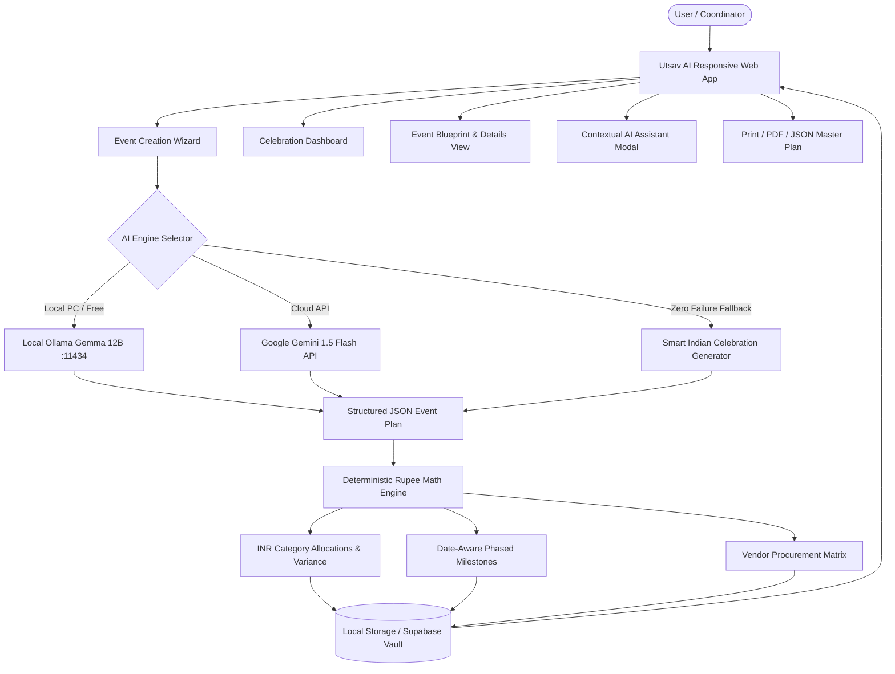

# Utsav AI — Your Intelligent Celebration & Event Planner
> **Challenge 5: Celebration & Event Planner — GenAI-Powered Intelligent SaaS Solution**

[-10B981?style=for-the-badge&logo=vite)](https://github.com)
[%20%2B%20Gemini-8B5CF6?style=for-the-badge&logo=google)](https://deepmind.google/technologies/gemini/)
[](https://react.dev)
[-06B6D4?style=for-the-badge)](https://github.com)

---

## 1. Project Title & Overview

**Utsav AI** (उत्सव — *Celebration*) is an intelligent, full-stack Generative AI celebration and event-planning SaaS platform engineered specifically for the vibrant, multifaceted traditions of Indian celebrations.

Whether planning a **Grand Royal Palace Wedding in Jaipur**, an **intimate 1st birthday superhero milestone**, a **high-octane 3-day college cultural festival**, or a **serene Griha Pravesh family pooja**, Utsav AI transforms chaotic multi-spreadsheet planning into a synchronized, stress-free digital experience.

It pairs **generative reasoning** (creative themes, custom menus, time-slotted activity sequences, contingency mitigations, and WhatsApp invitation broadcasts) with **100% deterministic financial arithmetic** (itemized rupee allocation, live variance detection, and emergency reserve buffers).

---

## 2. Problem Statement

Planning celebrations in India is notoriously stressful and fragmented:
1. **Budget Leakage & Unforeseen Costs**: Over 70% of Indian weddings and milestone parties overrun their budgets due to vague estimates and absence of emergency reserves.
2. **AI Arithmetic Hallucinations**: Standard LLMs frequently fabricate financial arithmetic, hallucinate verified vendor quotes, or claim non-existent venue availability.
3. **Cultural & Dietary Nuances**: Generic international planning tools fail to understand critical traditions like *Pheras*, *Sangeet dance flows*, *Jain/Pure-Veg dietary restrictions*, or *auspicious Muhurat timing*.
4. **Token Costs & Privacy Concerns**: Hosting large planning workflows on commercial cloud APIs can become expensive and expose sensitive family budgets.

**Utsav AI solves this with a hybrid architecture**:
- **Deterministic Math Engine**: Computes exact rupee allocations, actual spend tracking, and reserve funds with zero rounding drift or AI math errors.
- **Dual-Brain AI Engine**: Integrates on-device **Ollama Gemma 12B** (zero API tokens consumed, 100% local privacy) paired with **Google Gemini Cloud AI** and a domain-specific fallback generator.
- **Authentic Cultural Framework**: Tailored for Indian celebration categories, cuisines, decor archetypes, and WhatsApp communication norms.

---

## 3. Key Features

### 🌟 1. Multi-Step Event Creation Wizard
- **Stage 1 (Essentials)**: Event title, category selector (Weddings, Birthdays, Anniversaries, College Fests, Cultural Celebrations, Corporate Galas, Family Gatherings), date picker, and destination picker with quick tags (Jaipur, Udaipur, Goa, Bengaluru, etc.).
- **Stage 2 (Scale & Economics)**: Guest count slider (10 to 1,200+ guests) and total planned budget in INR (₹) with presets from ₹50,000 to ₹50,00,000.
- **Stage 3 (Vibe & Culinary Preferences)**: Venue preferences (Palace Resort, Open Lawn, AC Banquet, Beachfront), Dietary requirements (Pure Veg, Jain, Mixed Veg/Non-Veg, Vegan), and Core planning priorities (Affordability, Luxury Grandeur, Sustainability, Guest Experience).
- **Stage 4 (AI Engine Selection & Synthesis)**: Choose between **Local Ollama Gemma 12B**, **Google Gemini Cloud**, or **Auto-Adaptive AI**.

### 💰 2. Deterministic Smart Budget Calculator
- Category-wise deterministic allocation across 8 core expense buckets: *Catering & Beverages, Venue Rental, Decor & Mandap, Photography/Cinematics, Music & DJ, Attire & Styling, Logistics & Invites, and Contingency Reserve*.
- **Interactive Recharts Visualizations**:
  - Donut Chart displaying percentage category allocation.
  - Bar Comparison Chart evaluating Estimated vs. Actual committed spend.
- **Itemized Financial Ledger**: Real-time inline editing of estimated and actual costs, instant variance calculation, and visual **Overrun warning badges** when costs exceed baseline allocations.
- **Contingency Reserve Slider**: Configurable 5%, 10%, or 15% emergency reserve dynamically isolated from operational allocations.

### ⏱️ 3. Date-Aware Milestone Timeline
- Automatically generates date-aware preparation milestones categorized into structured phases:
  - *90–60 Days Out: Concept & Primary Venue Booking*
  - *60–30 Days Out: Vendor Shortlisting & Digital Invites*
  - *30–14 Days Out: Menu Tastings & Logistics Confirmations*
  - *14–7 Days Out: Final Headcounts & Rehearsals*
  - *Final 48 Hours: Setup Verification & Contingency Briefing*
  - *Event Day: Activity Slot Execution & Stage Reveals*
- Interactive milestone check-offs with celebratory confetti particles and status filtering.

### 🤝 4. Vendor Research & Procurement Matrix
- Vendor pipeline tracking without hallucinatory vendor contact fabrication.
- Stages: **To Research ➔ Shortlisted ➔ Contacted ➔ Confirmed**.
- Tracks estimated allocations, target quotes, priority badges, and specific operational requirements.

### 💡 5. Curated Themes & Aesthetic Moodboards
- 6 curated Indian celebration archetypes:
  1. *Royal Rajputana & Marigold Splendor* (Jaipur / Udaipur palace style)
  2. *Minimalist Pastel Chic & Fairy Sundowner* (Modern terrace & garden cocktail)
  3. *South Indian Temple Classical Elegance* (Brass Kuthuvilakku, Mogra & Kanjeevaram)
  4. *Neon Cyberpunk / Electric Odyssey* (College fests & Sangeet after-parties)
  5. *Eco-Conscious Zero-Waste Celebration* (Clay kulhads, potted giveaways, seed paper)
  6. *Bollywood Retro & Red Carpet Glam* (70s/90s filmi nostalgia & marquee lights)
- Click-to-copy HEX chromatic swatches, decor guides, and 1-click event planning launcher.

### 🤖 6. Contextual Real-Time AI Concierge
- In-app AI Assistant grounded with the selected event's real parameters (budget, guests, destination, diet).
- Quick action pills:
  - *"How can I reduce our budget by 15%?"*
  - *"Suggest signature vegetarian catering menu items"*
  - *"What are key weather/rain risks for our date?"*
  - *"Draft a formal WhatsApp invitation message"*

### 📱 7. 1-Click WhatsApp & Social Invite Broadcast
- Formats celebratory invitation copy with customized emojis, date, venue, dietary style, and RSVP notes.
- 1-click copy for broadcast distribution.

### 📄 8. Master Plan Export & PDF Printing
- Clean `@media print` layout stripping UI chrome to output a publication-ready event blueprint.
- JSON backup download for offline archival or migration.

---

## 4. Technology Stack

| Layer | Technology | Rationale |
|---|---|---|
| **Frontend Framework** | React 18 + Vite 6 + TypeScript | Ultra-fast HMR, strict type safety, zero build overhead |
| **Styling & Theme** | Tailwind CSS 3 | Bespoke charcoal palette (`#0B0D14`), warm gold (`#F59E0B`), and violet |
| **Icons** | Lucide React | Consistent, accessible SVG icons |
| **Data Visualization** | Recharts | Responsive SVG charts for budget breakdown and spend comparisons |
| **Micro-Interactions** | Canvas-Confetti | Rewarding feedback on milestone task completion |
| **Generative AI** | Google Gemini 1.5 Flash + Local Ollama Gemma 12B | Dual-engine architecture for cloud reasoning or 100% offline zero-token execution |
| **Persistence** | LocalStorage + Supabase schema ready | Instant zero-config demo mode with persistent event state |

---

## 5. Architecture & Data Flow



---

## 6. How the GenAI Service Is Used

1. **Local Gemma 12B via Ollama (`http://127.0.0.1:11434`)**:
   - Executes offline on the user's PC using Ollama.
   - **Zero token cost**: Enables unlimited plan generations, chat consultations, and menu variations without consuming paid cloud API quotas.
   - Complete family privacy: Guest counts, financial budgets, and dates never leave the local machine.
2. **Google Gemini 1.5 Flash Cloud API**:
   - Provides high-parameter cloud reasoning with structured JSON responses adhering to a strict schema.
   - Dynamically active whenever `VITE_GEMINI_API_KEY` is present.
3. **Deterministic Math Barrier**:
   - AI is **never** permitted to calculate financial balances or subtotals.
   - The deterministic math engine guarantees that the sum of category allocations and contingency buffers equals `totalBudget` to the exact rupee without rounding error or hallucination.

---

## 7. Installation & Local Development

### Prerequisites
- Node.js **v18+** (Tested on Node v24.20.0, npm 11.7.0)
- (Optional for offline AI): [Ollama](https://ollama.com/) with `gemma4:12b` (`ollama run gemma4:12b`)

### Step 1: Clone Repository & Navigate
```bash
git clone https://github.com/aryan/utsav-ai.git
cd utsav-ai
```

### Step 2: Install Dependencies
```bash
npm install
```

### Step 3: Configure Environment Variables (Optional)
```bash
cp .env.example .env
```
*Note: The application works out-of-the-box in Demo / Local AI mode even without API keys!*

### Step 4: Run Development Server
```bash
npm run dev
```
Open [http://localhost:5173](http://localhost:5173) in your browser.

### Step 5: Build for Production & Preview
```bash
npm run build
npm run preview
```

---

## 8. Environment Variable Configuration

Create a `.env` file in the root directory:

```env
# Google Gemini API Key (Optional)
VITE_GEMINI_API_KEY=your_gemini_api_key_here

# Local Ollama Inference (Default: http://127.0.0.1:11434)
VITE_OLLAMA_ENDPOINT=http://127.0.0.1:11434

# Supabase Configuration (Optional)
VITE_SUPABASE_URL=https://your-project.supabase.co
VITE_SUPABASE_ANON_KEY=your_supabase_anon_key_here
```

---

## 9. 2–3 Minute Demo Video Script

**Title:** *Utsav AI — The Future of Indian Celebration Planning*  
**Duration:** ~2 minutes 30 seconds  

| Timestamp | Screen | Voiceover / Action |
|---|---|---|
| **0:00 – 0:25** | **Landing Page** | *"Planning an Indian wedding or celebration usually means battling 10 different spreadsheets, unpredictable vendor costs, and budget overruns. Welcome to Utsav AI — your intelligent celebration planner combining cultural understanding, Generative AI, and 100% deterministic rupee budgeting."* |
| **0:25 – 0:50** | **Event Creation Wizard** | *"Let's plan a celebration. We open the Event Creation Wizard. We enter 'Aarav & Meera's Sangeet in Udaipur', select 250 guests, a budget of ₹15,00,000, and a Royal Heritage aesthetic with Pure Vegetarian catering. Notice we can choose between our on-device Local Gemma 12B model for zero token costs or Google Gemini in the cloud. Let's click Generate!"* |
| **0:50 – 1:20** | **Event Blueprint & Budget** | *"Within seconds, Utsav AI creates our master plan. Look at the Smart Budget Calculator: every single rupee of our ₹15 Lakhs is deterministically allocated with zero rounding errors. We have an interactive Recharts category donut, estimated vs actual spend comparison, and a 10% contingency reserve locked for unexpected expenses. If we edit any line item, totals update instantaneously."* |
| **1:20 – 1:45** | **Timeline & Vendor Matrix** | *"Next, the Date-Aware Timeline breaks down preparation milestones from 90 days out down to the final 48 hours and the event day schedule. Tapping a milestone triggers instant completion with confetti. In the Vendor Matrix, we track procurement from research to contracted quotes without hallucinated business claims."* |
| **1:45 – 2:10** | **AI Concierge & WhatsApp Invites** | *"Need to cut expenses? We open the Utsav AI Advisor and tap 'How can I reduce our budget by 15%?' The AI immediately analyzes our Udaipur venue and menu to suggest practical seasonal floral swaps and menu optimizations. In the WhatsApp tab, an emoji-rich invitation is drafted and ready to broadcast in one click."* |
| **2:10 – 2:30** | **Export & Conclusion** | *"Finally, we can export the entire blueprint to a clean printable PDF or JSON backup. Utsav AI is fast, culturally attuned, deterministic, and production-ready. Thank you!"* |

---

## 10. Deployed Application Link & Vercel Deployment

### Deploy to Vercel in 1 Minute:
1. Push this repository to your GitHub account.
2. Visit [Vercel Dashboard](https://vercel.com/new).
3. Import the `utsav-ai` repository.
4. Framework Preset: **Vite**.
5. Click **Deploy**.

---

## 11. Limitations & Future Roadmap

- **Multi-Day Itinerary Sequencing**: Expanding from single-day/sangeet schedules to multi-day Indian wedding sagas (Haldi, Mehendi, Sangeet, Shaadi, Reception) with dedicated sub-budgets.
- **Direct WhatsApp Business API**: Direct guest RSVP collection and dietary logging via automated WhatsApp bots.
- **Collaborative Family Permissions**: Role-based access control where the bride/groom, parents, and wedding planners have isolated editing rights.

---

## 12. Suggested LinkedIn Launch Post

```markdown
🎉 Excited to unveil Utsav AI — Your Intelligent Celebration Planner! 🪔✨

Planning celebrations in India (from grand royal weddings in Jaipur to vibrant college fests and milestone birthdays) is one of the most culturally rich yet logistically chaotic experiences. Most planners battle multiple spreadsheets, budget leakages, and generic tools that don't understand Indian traditions.

To solve this for Challenge 5, I built Utsav AI:
🔹 Deterministic Smart Budgeting: 100% exact rupee (₹) math with live variance tracking, Recharts breakdowns, and dynamic contingency reserves. Zero AI math hallucinations!
🔹 Dual-Brain AI Architecture: Runs locally on-device via Ollama Gemma 12B (zero API tokens consumed, 100% private) + Google Gemini Cloud API.
🔹 Culturally Attuned Blueprints: Time-slotted ceremony flows, authentic decor moodboards with copyable HEX palettes, and dietary considerations (Pure Veg, Jain, Vegan).
🔹 Date-Aware Timeline & Vendor Matrix: Structured milestones from 90 days out to the final 48 hours.
🔹 1-Click WhatsApp Broadcast Generator: Formats celebration invites with emojis and key dates ready for family groups.

Built with React 18, TypeScript, Tailwind CSS, Recharts, and Google Generative AI.

Check out the live project and source code on GitHub! 🚀

#GenAI #ArtificialIntelligence #ReactJS #TypeScript #EventPlanning #GeminiAPI #Gemma #WebDevelopment #SaaS #BuildInPublic
```

---

*Engineered with precision for Challenge 5: Celebration & Event Planner.*
